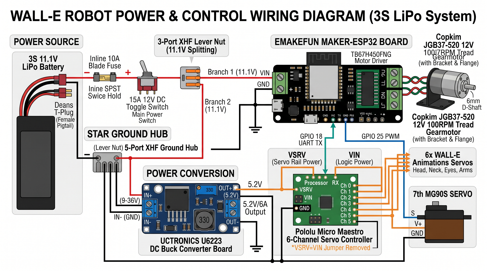

# rusty_Walle 🤖 (`SW@GL0RD WALL-E`)

Embedded Rust robotics firmware running on **ESP32 + FreeRTOS** (`esp-idf-hal` / `esp-idf-svc`) to control a 3D-printed **WALL-E** robot (based on chillibasket's WALL-E v3.0 mechanical design).

Built around a **hardware-agnostic, trait-based systems architecture** that decouples anatomical robot poses, expressions, and live HUD diagnostics from underlying PWM/UART actuator controllers, SPI displays, and DC motor drivers.

---

## 🏗️ Software & Systems Architecture

* **Runtime & Stack:** `std`-enabled Rust on **ESP-IDF / FreeRTOS** (`esp-idf-hal` `0.46+`, `esp-idf-svc`), deterministic task scheduling, and thread-safe shared bus/state access (`Arc<Mutex<...>>`).
* **Hardware Abstraction Layer (`src/actuators/`):**
  * **`ServoActuator` Trait (`mod.rs`):** Unified interface (`set_position(0.0..=1.0)`, `set_speed`, `set_accel`, `limp`) shared across heterogeneous servo backends.
  * **`MaestroBus` & `MaestroChannel` (`pololu_servo.rs`):** Thread-safe UART driver (`115,200` baud, Compact Serial Protocol with `0xAA` auto-baud initialization) controlling 6 upper-body servos with hardware trapezoidal speed/acceleration profiling.
  * **`LedcServo` (`ledc_servo.rs`):** Hardware-generic ESP32 LEDC PWM driver (`50 Hz`, 14-bit duty resolution) driving the 7th servo channel directly from the microcontroller.
  * **`Tb67h450Motor` (`tb67h450.rs` - Next):** `DcMotor` trait implementation for dual onboard Toshiba TB67H450FNG H-bridge tread drivers.
* **Appendage & Kinematic Layer (`src/appendage_controller/`):**
  * **`WallEBody` (`body.rs`):** High-level anatomical joint controller (`head_rotation`, `neck_top`, `neck_bottom`, `eye_left`, `eye_right`, `arm_left`, `arm_right`) storing `Box<dyn ServoActuator>` and directly updating `Arc<Mutex<TelemetryState>>` on every pose command.
  * **`WallEMap` & `JointCal` (`mapping.rs`):** Centralized per-joint calibration (`min_us`, `max_us`, `inverted`, `home`) and channel-to-joint binding table.
* **Diagnostics & Display Subsystem (`src/display/` & `src/diag/`):**
  * **`DiagnosticsDisplay` Trait (`display/mod.rs`) & `St7735Display` (`display/st7735.rs`):** Hardware-abstracted SPI TFT renderer configured for the 1.8" ST7735 in `160 × 128` Landscape orientation (`embedded-graphics`).
  * **Background Telemetry Task (`diag/mod.rs` & `telemetry.rs`):** Non-blocking FreeRTOS task (`10 Hz` refresh) rendering the `SW@GL0RD WALL-E` banner, 10-segment color solar charge meter, Maestro bus status, active pose, and real-time joint positions without stalling servo control loops.

---

## 📁 Repository Structure

```text
src/
├── main.rs                      # Peripheral setup, SPI/UART init, & main pose loop
├── actuators/                   # Hardware-agnostic actuator traits & drivers
│   ├── mod.rs                   # ServoActuator trait (set_position, speed, accel, limp)
│   ├── pololu_servo.rs          # Thread-safe MaestroBus (Arc<Mutex>) & MaestroChannel
│   └── ledc_servo.rs            # ESP32 50 Hz LEDC PWM servo driver
├── appendage_controller/        # Anatomical robot kinematics & calibration
│   ├── mod.rs
│   ├── body.rs                  # WallEBody (7 joints + live TelemetryState updates)
│   └── mapping.rs               # WallEMap & JointCal central calibration table
├── display/                     # Hardware display abstraction & drivers
│   ├── mod.rs                   # DiagnosticsDisplay trait
│   └── st7735.rs                # 1.8" ST7735 SPI TFT renderer (160x128 Landscape)
└── diag/                        # Non-blocking background telemetry subsystem
    ├── mod.rs                   # FreeRTOS HUD task spawner (10 Hz refresh)
    └── telemetry.rs             # Shared TelemetryState struct
```

---

## 🔧 Hardware Bill of Materials (BOM) & Pinout

| Subsystem | Component | Exact Model / Spec | Interface / Notes |
| :--- | :--- | :--- | :--- |
| **Compute / MCU** | Emakefun Maker-ESP32 | Dual-core Xtensa LX6, FreeRTOS, onboard H-bridges | Powered at `11.1V` via green `VIN` / `GND` screw terminals; `IO` slide switches set to **`IO`** |
| **Servo Controller** | Pololu Micro Maestro 6-Channel | `UART1` (`GPIO 18` TX $\rightarrow$ Maestro `RX`, `115,200` baud) | `VSRV=VIN` jumper **removed**; `5.2V` fed to both `VSRV` and `VIN`, tied to common `GND` |
| **Upper-Body Actuators** | 7x MG90S Micro Servos | Metal-gear micro servos | Channels `0–5` on Pololu Maestro; Channel `6` (`arm_right`) on `GPIO 25` (`LEDC`) |
| **Diagnostics HUD** | 1.8" ST7735 Color SPI TFT | `SPI2` (`26 MHz`), `160 × 128` Landscape | Styled after WALL-E's solar charge meter (`3.3V` logic/backlight) |
| **Drive Motors** | 2x 12V Geared DC Tread Motors | **Copkim JGB37-520** (`12V 100RPM`, 37mm, Eccentric 6mm D-Shaft) | Driven via Maker-ESP32 onboard Toshiba `TB67H450FNG` H-bridges (remove L-bracket for pod mount) |
| **Battery Source** | 3S LiPo Battery Pack | Zeee `11.1V` (`3S`, `Deans T-Plug`) + 14 AWG Female Deans Pigtail | Bench testing with `5500mAh` 80C pack (compact `2200mAh` 3S shorty pack for final torso closure) |
| **Circuit Protection** | Inline Blade Fuse Holder | 16 AWG Inline ATM Mini Fuse Holder w/ **10A Fuse** | Spliced inline on the main `+11.1V` red battery lead before the cutoff switch |
| **Main Power Cutoff** | Heavy-Duty Toggle Switch | 2-Pin SPST Toggle Switch (`15A 12V DC`) | Breaks/connects the `+11.1V` rail downstream of the 10A inline fuse |
| **Power Distribution** | XHF Lever Wire Connectors | 30-Pc Lever Nut Assortment (`28–12 AWG`, 2/3/5-port) | **1× 3-Port** splits `+11.1V` to Maker-ESP32 & buck converter; **1× 5-Port** forms the Star `GND` hub |
| **5V Servo Regulator** | Step-Down Buck Converter | **UCTRONICS U6223** (`9–36V` In $\rightarrow$ `5.2V / 6A` Out) | Screw-terminal buck module supplying isolated `5.2V` to Maestro `VSRV`/`VIN` and 7th servo |
| **Chassis** | 3D-Printed WALL-E v3.0 | Chillibasket WALL-E v3.0 STL set | Printed in PLA on Bambu Lab P2S |
| **Chassis** | 3D-Printed WALL-E v3.0 | Printed in PLA on Bambu Lab P2S |

### Power Distribution & Control Schematic



### Maker-ESP32 Wiring Map
> **Hardware Note:** On the Emakefun Maker-ESP32, ensure the onboard Motor/IO slide switches are set to **`IO`** so `GPIO 14`, `GPIO 15`, and `GPIO 17` operate as standard digital GPIOs.

| Peripheral | Signal | Maker-ESP32 Pin | Notes |
| :--- | :--- | :--- | :--- |
| **Pololu Maestro** | `TX` $\rightarrow$ Maestro `RX` | `GPIO 18` | `UART1` @ `115,200` baud |
| **Pololu Maestro** | `RX` *(unused)* | `GPIO 19` | Unidirectional TX control |
| **Right Arm Servo** | `PWM` Signal | `GPIO 25` | 50 Hz `LEDC` (`Timer0` / `Ch0`) |
| **ST7735 TFT** | `VCC` / `BLK (LED)` | `3.3V` | Logic power & full backlight |
| **ST7735 TFT** | `GND` | `GND` | Common ground across ESP32, Maestro & TFT |
| **ST7735 TFT** | `SCL` (`SCLK`) | `GPIO 14` | `SPI2` Clock (`26 MHz`) |
| **ST7735 TFT** | `SDA` (`MOSI`) | `GPIO 12` | `SPI2` Data (keep free of external pull-ups) |
| **ST7735 TFT** | `CS` | `GPIO 15` | Chip Select |
| **ST7735 TFT** | `A0` (`DC`) | `GPIO 26` | Data / Command select |
| **ST7735 TFT** | `RST` (`RES`) | `GPIO 17` | Hardware Reset |

---

## 🚀 Build & Flash

1. **Source the ESP-IDF / Rust Xtensa environment:**
   ```bash
   . ~/export-esp.sh
   ```
2. **Build and flash to the Maker-ESP32:**
   ```bash
   cargo run --release
   ```

---

## ✅ Systems Engineering & Integration Status

- [x] **End-to-End UART Servo Control:** Verified Compact Serial Protocol framing, `0xAA` auto-baud handshake, speed/acceleration profiling, and physical MG90S actuation across all 6 Pololu Maestro channels (`0..=5`).
- [x] **Direct ESP32 LEDC Servo Driver:** Implemented and bench-verified 50 Hz 14-bit `LedcServo` on `GPIO 25` conforming to `ServoActuator`.
- [x] **Split Power Rail Validation:** Verified external servo power injection (`VSRV`/`BAT`) with common ground isolation to prevent MCU brownouts.
- [x] **Appendage Controller & Calibration Integration:** Bound calibrated `WallEMap` channels into `WallEBody` (`home_all`, `look_at`, `set_eyes`, `set_arms`, `limp_all`) with automatic `TelemetryState` synchronization.
- [x] **Front Chassis Diagnostics & Charge-Meter Display (`ST7735`):** Implemented `DiagnosticsDisplay` trait, `St7735Display` (`160 × 128` Landscape), and non-blocking FreeRTOS telemetry rendering (`SW@GL0RD WALL-E` banner, 10-bar solar charge meter, live joint/bus status).
- [ ] **Tread Drive & Differential Kinematics:** Complete `tb67h450.rs` (`20 kHz` LEDC PWM) and differential tread mixer.
- [ ] **Full Chassis Assembly & Wiring Harness:** Final mechanical horn indexing at `0.5` neutral home, chest display bezel mount, and internal harness routing.

---

## 🔭 Future Work & Subsystem Roadmap

* **Eye Vision System (Binocular / Eye Cameras):**
  * Integrate compact camera modules inside WALL-E's eye housings for live video streaming, face/object tracking, and closed-loop head/eye pan-tilt tracking via `WallEBody`.
* **Audio & Sound Effects Subsystem (MP3 / I2S Audio):**
  * Add an MP3 playback module (e.g., DFPlayer Mini over UART or an I2S DAC/amplifier) triggered asynchronously from FreeRTOS tasks to play WALL-E vocalizations, startup chimes, and servo/motor sound effects synchronized with expressions.
* **Wireless Telemetry & Remote Control (LoRa / ESP-NOW):**
  * Integrate wireless link (Heltec V3 LoRa / ESP-NOW) for remote teleoperation, pose triggering, and battery voltage telemetry.